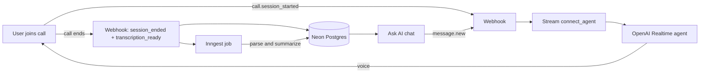

<div align="center">

<br />
<br />

<h1>Elara</h1>

<p><strong>Meet with AI. Talk in real time. Revisit every call.</strong></p>

<p>An AI voice-agent meeting platform. Create an agent, call it live with OpenAI Realtime over Stream Video, then get the recording, a full transcript, a written summary, and a chat to ask about anything that was said.</p>

<p>
  <a href="#features">Features</a>&nbsp;&nbsp;&bull;&nbsp;&nbsp;
  <a href="#webhook-events">Events</a>&nbsp;&nbsp;&bull;&nbsp;&nbsp;
  <a href="#getting-started">Quick start</a>&nbsp;&nbsp;&bull;&nbsp;&nbsp;
  <a href="#deploy-on-render">Deploy</a>&nbsp;&nbsp;&bull;&nbsp;&nbsp;
  <a href="#how-it-works">Architecture</a>&nbsp;&nbsp;&bull;&nbsp;&nbsp;
  <a href="#project-structure">Structure</a>
</p>

<br />

<p>
  <a href="https://nextjs.org"></a>&nbsp;
  <a href="https://getstream.io"></a>&nbsp;
  <a href="https://platform.openai.com"></a>&nbsp;
  <a href="https://www.inngest.com"></a>&nbsp;
  <a href="https://neon.tech"></a>&nbsp;
  <a href="https://www.better-auth.com"></a>&nbsp;
  <a href="https://polar.sh"></a>&nbsp;
  <a href="https://render.com"></a>
</p>

<p>
  <a href="https://elaravoiceai.onrender.com"></a>
</p>

</div>

<br />

> Give an agent a persona, join a video call where it listens and talks back as the call happens, and when you hang up you get a recording, a transcript, and a summary. The same agent then answers your questions about the meeting afterwards.

---

## Features

<table>
  <tr>
    <td width="50%" valign="top">
      <strong>Live voice agents</strong><br />
      An AI agent joins the call, hears you, and replies out loud through OpenAI Realtime. Stream wires the audio to OpenAI, so there is no WebSocket code to maintain.
    </td>
    <td width="50%" valign="top">
      <strong>Custom personas</strong><br />
      Each agent has a name and a block of instructions. That same persona runs the live call and the chat afterwards.
    </td>
  </tr>
  <tr>
    <td width="50%" valign="top">
      <strong>Transcripts and recordings</strong><br />
      Stream records and transcribes every call. The URLs arrive by webhook and get stored on the meeting.
    </td>
    <td width="50%" valign="top">
      <strong>Written summaries</strong><br />
      Once the transcript lands, an Inngest job parses it, names each speaker, and writes a Markdown summary with <code>gpt-4o-mini</code>.
    </td>
  </tr>
  <tr>
    <td width="50%" valign="top">
      <strong>Ask about past meetings</strong><br />
      Every finished meeting has its own chat channel. The agent answers follow-up questions from the summary and the last few messages.
    </td>
    <td width="50%" valign="top">
      <strong>Safe under retries</strong><br />
      Webhooks claim the meeting atomically and guard the agent slot, so a redelivered event never connects a second agent or loses a transcript.
    </td>
  </tr>
  <tr>
    <td width="50%" valign="top">
      <strong>Typed front to back</strong><br />
      tRPC, TanStack Query, and Zod run from Postgres to React. Agent and meeting lists page, search, and filter.
    </td>
    <td width="50%" valign="top">
      <strong>Auth and billing</strong><br />
      Better Auth (GitHub, Google, email and password) scopes every record to its owner. Polar runs the upgrade flow.
    </td>
  </tr>
</table>

<br />

## Webhook events

Stream runs the meeting lifecycle through signed webhooks at `POST /api/webhook`. Each event maps to one state change:

| Event | Trigger | Action |
|-------|---------|--------|
| `call.session_started` | A call begins | Claim the meeting (`upcomming` to `active`), connect the OpenAI Realtime agent, send its instructions and a greeting |
| `call.session_participant_left` | Someone leaves | End the call once the last human is gone. The agent leaving does not end it |
| `call.session_ended` | The call ends | Mark the meeting `pending`, record `endedAt` |
| `call.transcription_ready` | Transcript is ready | Save the transcript URL and send an Inngest event to summarize it |
| `call.recording_ready` | Recording is ready | Save the recording URL |
| `message.new` | A message in a finished meeting's chat | Reply with `gpt-4o-mini` using the summary, the agent instructions, and recent history |

Every request is checked against Stream's HMAC signature before any work runs.

---

## Getting started

### Prerequisites

You will need Node.js 20 or newer and npm. You also need accounts for a few services:

- A [Stream](https://getstream.io) app with both Video and Chat turned on. Video and Chat each have their own key pair.
- An [OpenAI](https://platform.openai.com) key with access to a Realtime model.
- A Postgres database. [Neon](https://neon.tech) works well.
- An [Inngest](https://www.inngest.com) account. The local dev server needs no account.
- [ngrok](https://ngrok.com) or another tunnel, so Stream can reach your webhook while you develop.

GitHub and Google OAuth apps and a [Polar](https://polar.sh) account are optional. Without them, email and password sign-in still works and billing is skipped.

### 1. Clone and install

```bash
git clone https://github.com/HarshaVardhanRobba/elaravoiceai.git
cd elaravoiceai
npm install
```

### 2. Set the environment

Create a `.env` file in the project root:

```bash
# Database (Neon / Postgres)
DATABASE_URL=

# Auth
BETTER_AUTH_SECRET=
BETTER_AUTH_URL=http://localhost:3000

# OAuth providers (optional)
GITHUB_CLIENT_ID=
GITHUB_CLIENT_SECRET=
GOOGLE_CLIENT_ID=
GOOGLE_CLIENT_SECRET=

# Stream (Video and Chat key pairs)
NEXT_PUBLIC_STREAM_VIDEO_API_KEY=
STREAM_VIDEO_SECRET_KEY=
NEXT_PUBLIC_STREAM_CHAT_API_KEY=
STREAM_CHAT_SECRET_KEY=

# OpenAI (Realtime for the live agent, gpt-4o-mini for summaries and chat)
OPENAI_API_KEY=

# Billing (optional)
POLAR_ACCESS_TOKEN=
```

### 3. Set up the database

Push the Drizzle schema:

```bash
npm run db:push
```

Browse the data any time with Drizzle Studio:

```bash
npm run db:studio
```

### 4. Point Stream at your tunnel

Start a tunnel to port 3000 and set your Stream app's webhook URL to `<tunnel>/api/webhook`:

```bash
npm run db:webhook   # ngrok http 3000, using the reserved domain in package.json
```

Stream then delivers `call.*`, `message.new`, and the rest to that URL. In production this points at your Render domain instead.

### 5. Run it

Open three terminals:

```bash
npm run dev          # Next.js, and it warms /api/webhook on boot
npm run db:inngest   # Inngest dev server, which runs the summary job
npm run db:webhook   # ngrok tunnel
```

That warm step matters. Under `next dev`, a route compiles on its first request, and Next drains the request body during that compile. The first Stream webhook would then arrive with zero bytes and fail signature verification. So `npm run dev` hits `/api/webhook` once on boot to compile it first. If you want plain `next dev` without the warmer, run `npm run dev:raw`.

Open [http://localhost:3000](http://localhost:3000), sign in, make an agent, start a meeting, and join the call.

---

## Deploy on Render

[Render](https://render.com) builds and hosts the app from GitHub.

### 1. Create the service

Push to GitHub and create a Web Service from the repo.

| Setting | Value |
|---------|-------|
| Build command | `npm run build` |
| Start command | `npm start` |

Every push to the connected branch triggers a new deploy.

### 2. Add production variables

Copy every key from your `.env` into the Render service environment, using production credentials. Set `BETTER_AUTH_URL` to your Render URL, such as `https://elaravoiceai.onrender.com`.

### 3. Point Stream at production

Set the Stream app's webhook URL to your deployed endpoint so call events reach the server:

```
https://<your-app>.onrender.com/api/webhook
```

A Stream app holds one webhook endpoint at a time. Point it at Render for production and back at ngrok for local work, or run a separate Stream app per environment so you never have to switch.

### 4. Add OAuth redirect URLs

Add the production callback URLs to your GitHub and Google OAuth apps, and add your Render domain to any Stream allowlist.

---

## How it works



A user and their agent join a Stream video call, which fires `call.session_started`. The webhook connects the OpenAI Realtime agent into the call, sends it the persona instructions, and asks it to greet the room. From there the agent listens and talks in real time while Stream records and transcribes. When the last human leaves, the call ends and the meeting turns `pending`.

On `call.transcription_ready`, an Inngest job downloads the JSONL transcript, matches each speaker to a user or agent in the database, and writes a Markdown summary. The meeting then turns `completed`. Each completed meeting carries a chat channel, and the agent answers questions there from the summary and the recent messages.

---

## Project structure

```text
src/
├── app/
│   ├── (auth)/              # Sign-in and sign-up
│   ├── (dashboard)/         # Agents, meetings, upgrade
│   ├── (marketing)/         # Landing page
│   ├── call/[meetingId]/    # Live call UI
│   └── api/
│       ├── auth/            # Better Auth handler
│       ├── inngest/         # Inngest function endpoint
│       ├── trpc/            # tRPC handler
│       └── webhook/         # Stream webhook: agent connect, lifecycle, chat
├── modules/
│   ├── agents/              # Agent CRUD (tRPC procedures and UI)
│   └── meetings/            # Meeting CRUD, tokens, transcript parsing
├── inngest/                 # Background summary pipeline
├── lib/                     # Stream clients, auth, avatars
└── db/                      # Drizzle schema and client
scripts/
└── dev-warm.mjs             # Starts next dev and warms /api/webhook
```

---

## Tech stack

Next.js 16 on the App Router with React 19 and Turbopack. Real time runs on Stream Video and Chat plus OpenAI Realtime through `@stream-io/openai-realtime-api`. Summaries and post-call chat use OpenAI `gpt-4o-mini`, driven by `@inngest/agent-kit`, with Inngest handling the background jobs. Data lives in Neon Postgres through Drizzle ORM. The API layer is tRPC with TanStack Query and Zod. Better Auth covers GitHub, Google, and email sign-in, and Polar handles billing. The interface is built with Tailwind CSS v4, Radix UI, lucide-react, Sonner, Recharts, and DiceBear avatars. Render hosts it.

---

<div align="center">
<sub>Built with Next.js, Stream, OpenAI Realtime, and Inngest.</sub>
</div>
